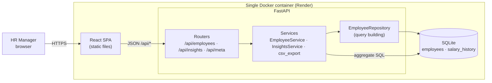
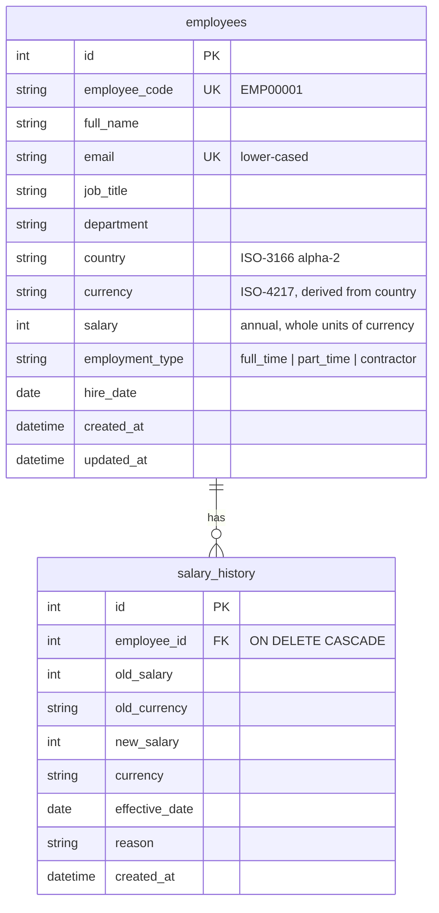

# Architecture

## Overview

In production, FastAPI serves the built SPA and the API from **one origin**. That means no CORS, one deployable
unit and one health check. In development, Vite runs on `:5173` and proxies `/api` to uvicorn on `:8000`.

## Backend layers (`backend/app`)

| Layer | Responsibility | Files |
|---|---|---|
| **Routers** | HTTP concerns only: query/body parsing, status codes, response models | `api/employees.py`, `api/insights.py`, `api/meta.py` |
| **Schemas** | Validation and serialization (Pydantic). Country is checked against the supported list, salary bounds are enforced, and emails are normalized | `schemas.py` |
| **Services** | Business rules: unique email → 409, salary-history recording, the currency-change rule, CSV streaming | `services/employee_service.py`, `services/insights_service.py`, `services/csv_export.py` |
| **Repository** | The single place that builds employee queries (filter, search, sort, page) | `repositories/employee_repository.py` |
| **Models** | SQLAlchemy 2 typed ORM models and constraints | `models.py` |
| **Currency** | Supported countries → currency, static USD rates, `to_usd()` | `services/currency.py` |

Domain errors (`errors.py`) are raised by services and mapped to HTTP responses in one exception handler.
`create_app(settings)` is a factory, so tests inject an in-memory database without monkeypatching.

## Data model

Indexes cover every filter and sort column, plus `(country, job_title)` for the job-title drilldown.
Schema changes go through Alembic migrations (`backend/alembic/versions`). A test asserts that the migrations
and the ORM models never drift apart.

## Frontend (`frontend/src`)

| Area | Notes |
|---|---|
| `api/` | Typed `fetch` client that mirrors the backend schemas. FastAPI 422 errors are flattened into readable messages |
| `hooks/` | TanStack Query hooks. Every mutation invalidates lists, dropdown options and insights. `useEmployeeQueryParams` keeps directory state in the URL |
| `pages/EmployeesPage` | MUI DataGrid with server-side paging and sorting, debounced search, filter bar, CSV export, create/edit/delete |
| `components/EmployeeFormDialog` | react-hook-form + zod, mirroring the API rules. Edits PATCH only the changed fields. A salary change asks for a reason and effective date |
| `components/EmployeeDetailDrawer` | Employee details and salary history (with % change) |
| `pages/InsightsPage` | KPI tiles, country chart and table, job-title drilldown with range bars, department payroll, USD histogram. Lazy-loaded |

## Request flow example: "give Ada a raise"

1. HR edits the salary in the dialog and adds the reason "Annual review".
2. The frontend sends `PATCH /api/employees/42 {salary, salary_change_reason, salary_effective_date}`, containing only the changed fields.
3. `EmployeeService.update` validates the request. If the country changed, it checks the currency rule. It then appends a `SalaryChange` row and commits once, so the update and its history row are atomic.
4. TanStack Query invalidates the list, history and insights queries, and the drawer shows the new history entry.
